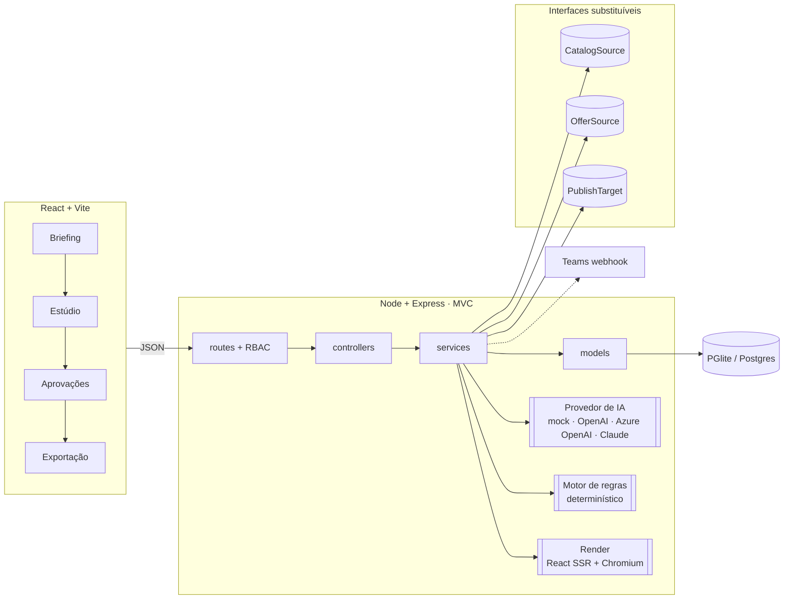
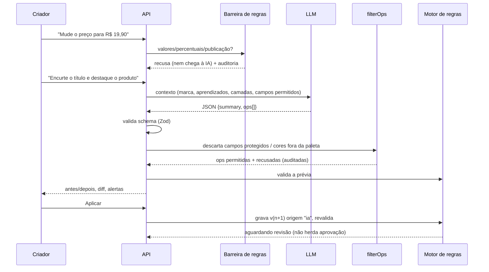

# Arquitetura e decisões técnicas

## 1. Princípio que guia tudo

**Separar texto criativo de dado comercial.**

| | Quem produz | Quem pode alterar | Onde vive |
|---|---|---|---|
| Título, subtítulo, CTA, selo | IA (conceito) e pessoas | criador (manual ou por pedido à IA) | `layer.text` |
| Preço, preço "de", vigência, praça | cadastro de ofertas | ninguém na peça; só na fonte | `layer.binding → OfferSource` |
| Nome e imagem do produto | catálogo | ninguém na peça | `layer.binding → CatalogSource` |
| Advertência de MIP | configuração de regras | administrador | `layer.binding → legal` |
| Cores, fontes, logo | manual de marca | administrador (tokens) | `brand.ts` |

A peça guarda **referências**, não valores. O valor é resolvido no momento da renderização e da validação, sempre com o dado mais recente da fonte. Por isso uma oferta que vence durante a revisão derruba a liberação sem ninguém precisar lembrar.

## 2. Visão geral

**`packages/shared`** é o coração: tipos, templates, renderizador, patch e regras. É usado pela API **e** pelo navegador, então:
- a prévia no editor e o PNG exportado são o mesmo componente (`Artboard`);
- as regras rodam igual no cliente (prévia instantânea) e no servidor (decisão final).

## 3. MVC na API

| Camada | Pasta | Responsabilidade |
|---|---|---|
| Model | `apps/api/src/models` | SQL e mapeamento de linhas. Nenhuma regra de negócio. |
| View | `apps/api/src/views` | Presenters: formato JSON entregue ao front. |
| Controller | `apps/api/src/controllers` | Lê a requisição, chama serviços, devolve a view. |
| Services | `apps/api/src/services` | Casos de uso: geração, edição, IA, validação, revisão, exportação, importação, métricas. |
| Rotas | `apps/api/src/routes` | Endpoints e **permissão por perfil verificada no servidor**. |

## 4. Fluxo de um pedido à IA (o caminho mais sensível)

Três camadas de defesa independentes: **barreira antes da IA**, **filtro depois da IA**, **regras sobre o resultado**. Mesmo que um modelo "obedeça" a um pedido indevido, a alteração não passa.

### Como a IA "aprende" a marca sem treinamento

Cada pedido de conceito leva um pacote de contexto montado na hora (`services/ai/prompts.ts`):

1. **Manual de marca** (tom de voz, exemplos aprovados e proibidos, termos vetados) lido de `brand.ts`.
2. **Aprendizados ativos**: motivos de reprovação que o admin transformou em regra de estilo.
3. **Exemplos aprovados**: títulos e subtítulos de até 4 conceitos já aprovados em outras campanhas (few-shot). A IA usa como referência de nível e tom, com instrução para não copiar.
4. **Briefing, produtos (com alegações autorizadas) e públicos**.

Quanto mais a equipe aprova e reprova, melhor o contexto, sem fine-tuning e com rastreabilidade (a auditoria registra quantos exemplos foram usados).

### Textos por canal

O mesmo conceito gera, por público, textos de push (título e texto), e-mail (assunto e pré-cabeçalho) e WhatsApp.
A IA escreve só a parte criativa; `composeMessages` acrescenta, por praça, a lista de ofertas com preço do cadastro,
a vigência, a advertência de MIP e o link. Produto sem oferta válida na praça fica de fora da mensagem (nunca há preço inventado).
As regras de texto das peças valem aqui também (COM-004, MAR-004, REG-003, MAR-005 e limite de caracteres), e um bloqueio
crítico impede aprovar o conceito.

## 5. Aprovação por conceito + exceção

Revisar peça por peça só move o gargalo do designer para o revisor. Então:

1. O revisor aprova **o conceito** (textos por público + família de layout).
2. Peças **derivadas** deterministicamente desse conceito (outro formato, outra praça, preço puxado da oferta válida) são liberadas **por herança**, desde que passem nas regras **sem alerta**.
3. Vão para a **fila de exceções**: edição manual, edição por IA, qualquer alerta.
4. **Crítico sempre bloqueia**, inclusive peças já aprovadas.
5. Nenhuma versão herda a aprovação de outra versão.

Implementado em `packages/shared/src/governance.ts` e coberto por testes.

## 6. Modelo de dados

`campaigns` → `concepts` (versionados) → `creatives` (formato × praça × público × produtos) → `versions` (imutáveis: doc, origem, instrução, ops, ops recusadas, diff, validação) → `reviews`.
Transversais: `offers` (fonte comercial), `products`, `segments`, `pracas`, `audit_events`, `learnings`, `ai_proposals`, `exports`, `critiques`, `settings`.

## 7. Decisões (ADR resumido)

| Decisão | Alternativa | Por quê |
|---|---|---|
| Templates + camadas em vez de imagem gerada inteira | gerar a peça toda por IA | Controle de marca, preço exato, editável, auditável, barato. |
| Renderizador único (React) para editor e exportação | Canvas no front + outro motor no back | "O que o revisor viu é o que sai." |
| LLM devolve **patch**, não peça | LLM reescreve o JSON inteiro | Menor superfície de erro; filtro por campo; diff legível. |
| Sem fine-tuning; contexto + aprendizados | treinar modelo próprio | Atualiza na hora, rastreável, sem dados reais suficientes. |
| Provedor de IA plugável + modo demonstração | acoplar a um fornecedor | Funciona sem chave; troca para Azure OpenAI sem refatorar. |
| PGlite em dev, Postgres em produção (mesmo SQL) | SQLite / ORM | Zero setup na demo e caminho direto para Azure Database for PostgreSQL. |
| Regras em código determinístico | IA julgando conformidade | Bloqueio não pode ser probabilístico. IA só aconselha (revisor de marca). |
| Manual de marca sintético e versionado | copiar a identidade real a partir de sites públicos | Repositório confidencial e uso de marca de terceiros; a arquitetura não depende dos valores: trocar a marca é editar `brand.ts` (e o seed do catálogo). |
| Deploy em contêiner único (Render/Azure Container Apps) | front e back separados | Um artefato, mesmo comportamento local e online, Chromium junto para exportação. |

## 8. Onde entram os dados reais

| Interface | Hoje | Integração real |
|---|---|---|
| `CatalogSource` (`services/sources.ts`) | tabela `products` sintética | PIM/catálogo do e-commerce (API) |
| `OfferSource` | tabela `offers` + importação CSV/XLSX | motor de preços / ERP / planilha oficial do trade |
| Imagem do produto | packshot SVG gerado | `Product.image = { type: 'url' }` apontando para o DAM |
| `PublishTarget` | ZIP em `data/exports` | DAM, SharePoint, pasta da agência |
| Autenticação | usuários sintéticos por perfil | Entra ID / SSO emitindo os mesmos 3 perfis |
| Notificação | auditoria (+ Teams se configurado) | canal de aprovação no Teams |

Nenhuma dessas trocas exige mexer em regras, templates, editor ou IA.

## 9. Segurança e privacidade

- Chaves de IA só no servidor. O front nunca chama o LLM.
- Permissões por perfil no back-end (`requireRole`); o front só esconde botões.
- Versões imutáveis; histórico e auditoria com autor, instrução, ops recusadas e provedor de IA.
- Sem dados pessoais nem dados de saúde. Públicos são segmentos amplos, sem PII.
- Repositório privado; dados e marca sintéticos.

## 10. Custos e escala (ordem de grandeza, a validar)

- 1 chamada de LLM por **conceito** (não por peça). As peças são derivadas sem IA. Uma campanha com 60 peças custa 1 chamada de conceito, mais 1 por pedido de edição e 1 por análise multimodal.
- A renderização PNG acontece só na exportação (Chromium reaproveitado).
- Medido no protótipo: 40 peças derivadas e validadas em cerca de 1 s (PGlite local).

## O que não está implementado

Para não apresentar como funcionalidade:

- Publicação automática em canais (proposital: fora do escopo e do princípio do produto).
- Integrações corporativas reais (contratos definidos, sem conectores).
- Geração de imagem de fundo por IA (o ponto de extensão é `decor`/`image`; hoje os fundos são procedurais, em 3 famílias de layout).
- Importação de arte em camadas (Figma/PSD) para adaptação.
- Disparo de push, e-mail e WhatsApp. Os **textos** desses canais são gerados, validados e exportados (`textos-canais.csv`); o envio fica com a ferramenta de CRM.
- Parecer jurídico. A plataforma faz triagem e bloqueio configuráveis; regras regulatórias precisam ser validadas por profissionais.
